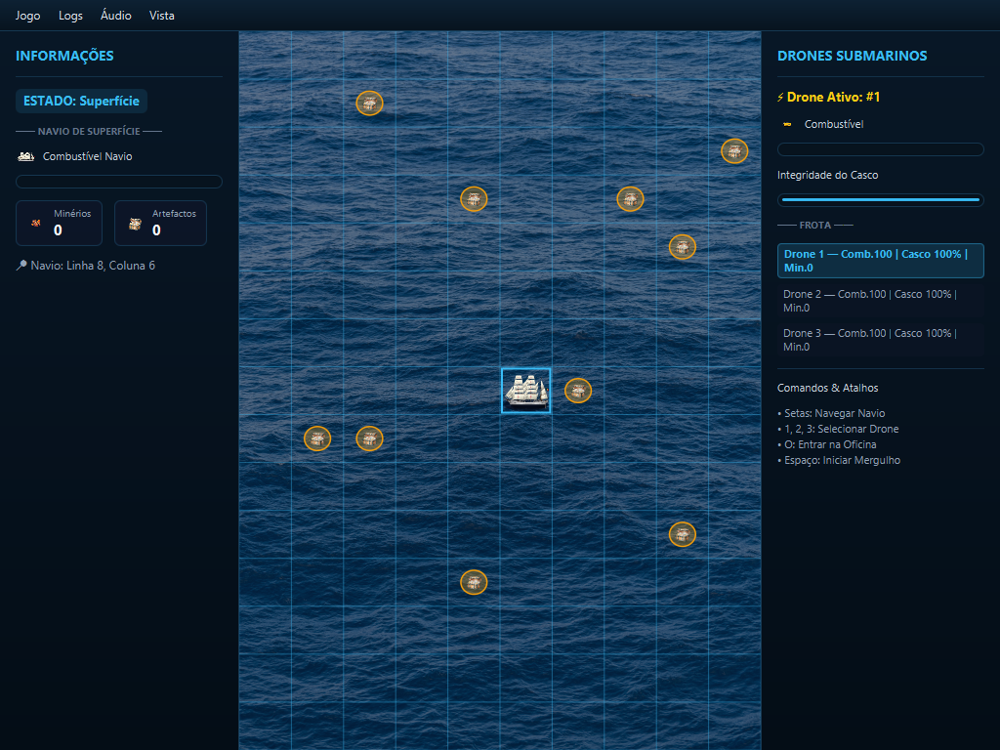

# DeepSea Mining - Interactive Desktop Application

[](https://www.oracle.com/java/)
[](https://openjfx.io/)
[](https://maven.apache.org/)
[](https://junit.org/junit5/)
[](#)

A complete underwater exploration and mining desktop game developed as part of the **Advanced Programming (PA)** course at the **Polytechnic Institute of Coimbra (ISEC)**.

The project highlights enterprise-grade Object-Oriented software engineering practices, featuring a strict **State Pattern (Finite State Machine)** for business logic, an **MVC / Observer architecture** for graphical UI decoupling, custom audio-visual integration, and serialization for game state persistence.

---

## 📸 Gameplay Preview




## 🌟 Key Features

* **Exploration & Strategy Gameplay:** Control autonomous drones navigating through deep ocean trenches, collecting minerals and artifacts while avoiding obstacles and sea currents.
* **Deterministic & Flexible Game Modes:** Configurable terrain maps, dynamic obstacle spawns, and puzzle-solving mechanics for recovering damaged exploration units.
* **Rich GUI & Media Integration:** JavaFX graphical interface with interactive canvas/grid rendering, audio feedback (sound effects, ambiance), and custom asset management.
* **State Persistence & History:** Full serialization support to save and restore game states at any point.
* **Automated Unit Testing:** Extensive test coverage implemented with **JUnit 5**.

---

## 🏗️ Software Architecture & Design Patterns

The architecture strictly adheres to separation of concerns and Gang of Four (GoF) design patterns:

### 1. State Pattern (Finite State Machine)
The core game engine is governed by a robust state machine, preventing illegal actions and decoupling state transitions from UI events.


### 2. Model-View-Controller (MVC) & Observer Pattern
* **Model (`pt.isec.pa.deepsea.model`):** Encapsulates the entire domain logic (`DeepSeaManager`, `Jogo`, data entities). Emits property change notifications to registered listeners.
* **View / UI (`pt.isec.pa.deepsea.ui`):** Built with JavaFX. Automatically responds to state mutations without directly holding business logic.
* **Controller:** Manages user input translation into domain commands.

### 3. Class Diagram & Domain Modeling


A comprehensive architectural report detailing design choices and algorithmic complexity is available in the [`reports/RelatórioPA.pdf`](reports/RelatórioPA.pdf) document.

---

## 🚀 Getting Started

### Prerequisites
* **Java Development Kit (JDK):** Version 21 or higher
* **Apache Maven:** Version 3.8+ (or your IDE's bundled Maven)

### Running the Application

1. **Clone the repository:**
   ```bash
   git clone https://github.com/7uppx/deep-sea-game.git
   cd deep-sea-game
   ```

2. **Compile and execute via Maven JavaFX plugin:**
   ```bash
   mvn clean compile javafx:run
   ```

3. **Run Unit Tests:**
   ```bash
   mvn test
   ```

---

## 📁 Repository Structure

```text
├── pom.xml                   # Maven dependencies and build configuration
├── reports/                  # Architecture documentation and UML diagrams
│   ├── Diagrama de Classes.png
│   ├── Diagrama de Estados.png
│   └── RelatórioPA.pdf
└── src/
    ├── main/
    │   ├── java/pt/isec/pa/deepsea/  # Domain logic, state machine & UI controllers
    │   └── resources/                # UI images, icons, and audio assets
    └── test/                         # Unit tests (JUnit 5)
```

---

## 👨‍💻 Authors & Academic Context

Developed by **João Bernardo Graça** as part of the **Degree in Computer Engineering (LEI)** - *Application Development (DA) branch* at **ISEC (Instituto Superior de Engenharia de Coimbra)**.
